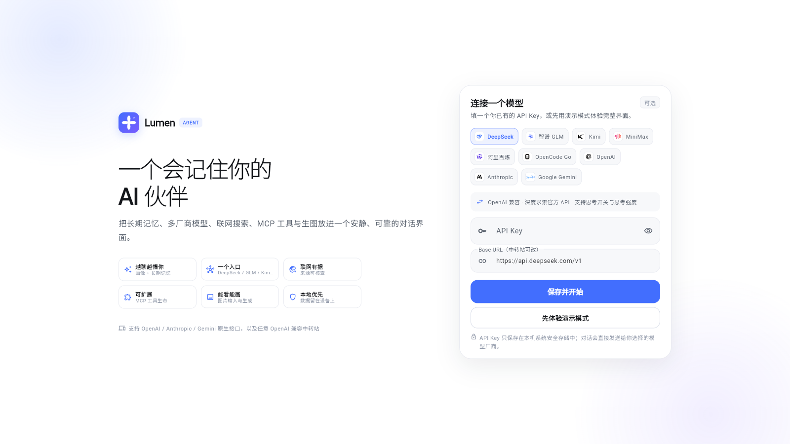
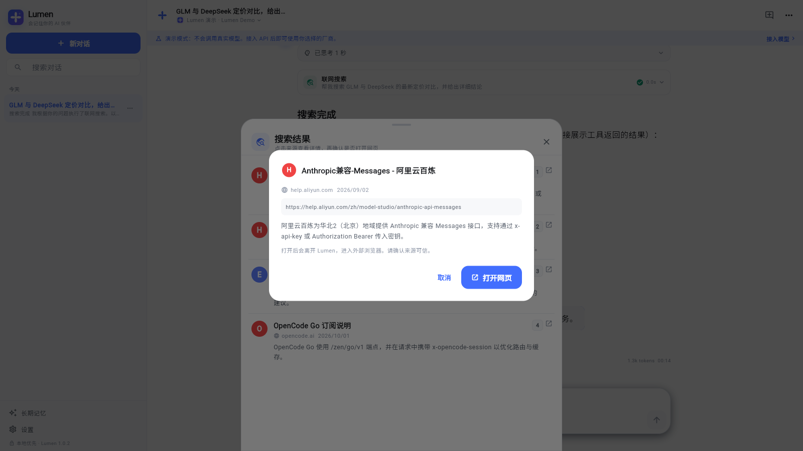
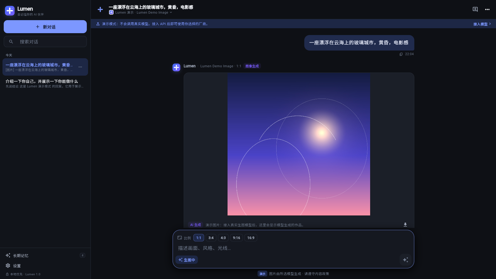

<div align="center">
  
  <h1>Lumen</h1>
  <p><strong>会记住你的本地优先 AI Agent</strong></p>
  <p>长期记忆、多厂商模型、联网搜索、MCP、文件与图片，放在一个安静的对话界面里。</p>

  [](https://flutter.dev)
  [](https://dart.dev)
  [](#android)
  [](#web)
  [](LICENSE)
  [](https://github.com/starsdragon/lumen/releases)
  [](https://github.com/starsdragon/lumen/stargazers)
</div>

Lumen 是一个本地优先的 Flutter AI 客户端，负责连接你选择的模型、保存记忆、组织搜索与工具调用。它把模型 API、长期记忆、联网搜索、MCP 工具、文件和图片放进同一个对话界面。模型由你选，Key 由你保管，会话和记忆默认只存在本机。



## 主要特性

- **记忆是可见、可改的。** 对话后自动抽取用户画像和长期事实，画像按字段合并，记忆去重后按相关度、重要性和时间检索。所有内容都能在“长期记忆”里查看、编辑、置顶或删除，画像和事实以结构化条目保存在本地。
- **模型接入不依赖单一厂商。** DeepSeek、智谱 GLM、Kimi、MiniMax、阿里百炼、OpenCode Go、OpenAI、Anthropic、Google Gemini 预置了各自的协议和模型清单，也支持任意 OpenAI 兼容中转站。模型列表通过平台 `/models` 更新，失败时保留缓存。
- **思考强度按平台原生参数发送。** 统一 7 档，适配器分别转换为 `thinking.type`、`reasoning_effort`、Anthropic adaptive thinking、Gemini `thinkingLevel` / `thinkingBudget` 等字段；遇到 400 会降级重试。
- **搜索源自动调度。** 按首选源、已配置的其他源和免费源依次尝试，最多 3 个源；网页并行读取，单个页面不可用时继续使用其他结果。搜索完成后，本次网页收在回答下方的折叠卡片里。
- **来源不塞进正文。** 回答里不出现 `[1]`、`[2]` 或末尾“参考来源”列表；本次网页收在回答下方的“N 个网页”按钮里，点开可看标题、域名、日期和摘要，再确认是否跳转。
- **文件和图片在本地处理。** 支持 PDF、DOCX、XLSX、PPTX、TXT/Markdown/JSON/CSV/HTML 和常见代码文件；图片可输入视觉模型，也可调用生图模型。文件文本在本地提取，作为不可信资料注入，不执行文件里的指令。
- **不需要账号。** 会话、消息、画像、记忆、MCP 配置保存在 Sembast；API Key 走系统安全存储。没有云端同步，也没有必须经过 Lumen 服务端的请求。
- **演示模式可直接跑。** 没有 API Key 也能体验完整 UI、流式输出、记忆、搜索卡片和生图流程，用来先确认交互再接入真实模型。

## 设计取舍

| 方向 | Lumen 的做法 |
|---|---|
| 模型接入 | 原生适配器 + 预置厂商 + 自定义 Base URL、Headers、Body |
| 搜索与来源 | 多源调度、网页并行读取、来源折叠；正文只写答案 |
| 记忆 | 本地结构化画像与事实，可编辑、可删除 |
| 存储 | 本地数据库 + 系统安全存储；无需账号 |
| 运行方式 | Android/Web 客户端，直接连接你选择的模型厂商 |
| 配置 | Key 放安全存储；高级 Headers/Body 与 MCP 配置单独保存 |

## Preview

| 对话、代码与公式 | 长期记忆 |
|---|---|
|  |  |

| 搜索来源与跳转确认 | 图片生成 |
|---|---|
|  |  |

截图来自 Web 演示模式；实际模型输出、字体和窗口尺寸会因平台不同。

## Quick Start

### 环境

- Flutter 3.38+，Dart 3.10+
- Android 构建需要 Android SDK 36（minSdk 24）
- Web 预览需要 Chrome 或 Edge

### Web

```bash
flutter pub get
flutter run -d chrome
```

构建静态文件：

```bash
flutter build web --release
cd build/web
python3 -m http.server 8137
# 打开 http://127.0.0.1:8137/
```

### Android

```bash
flutter build apk --release
# 产物：build/app/outputs/flutter-apk/app-release.apk
```

预构建 APK 见 [Releases](https://github.com/starsdragon/lumen/releases)。当前仓库的 release 包使用 Android debug 证书签名，正式分发前请换成自己的 keystore。

### 第一次打开

1. 选择“先体验演示模式”，不需要 Key。
2. 或选择一个厂商，填入 API Key 和 Base URL。
3. 需要联网搜索时，在“设置 → 联网搜索”里配置 Tavily、Google CSE、Bing、SearXNG 或 DuckDuckGo。
4. 需要 MCP 时，在“设置 → MCP”里添加 HTTP、SSE 或桌面 stdio server。

## 模型与思考强度

| 协议 | 预置平台 | 说明 |
|---|---|---|
| OpenAI Chat Completions | DeepSeek、智谱 GLM、Kimi、MiniMax、阿里百炼、OpenCode Go、OpenAI、自定义中转 | 流式 SSE、工具调用、`reasoning_effort` / `thinking` |
| Anthropic Messages | Anthropic | adaptive thinking、thinking signature、tool use |
| Google Gemini | Google Gemini | `thinkingLevel` / `thinkingBudget`、function calling |

- 模型清单从各平台 `/models` 读取；平台不提供该接口时保留内置清单并显示同步错误。
- 统一档位：关闭 / 自动 / 轻量 / 标准 / 深入 / 高强度 / 最大。具体字段映射和 OpenCode Go 端点排错见 [docs/DEEPSEEK_ANALYSIS.md](docs/DEEPSEEK_ANALYSIS.md)。
- 中转站可把思考风格设为“自动”；若上游拒绝思考参数，客户端会自动去掉参数重试。

## 联网搜索

搜索按可用源自动调度：

1. 先请求你选择的搜索源。
2. 当前源没有结果时，按已配置的 Tavily / Google / Bing / SearXNG 和免费的 Bing / DuckDuckGo 继续尝试，最多 3 个源。
3. 搜索成功后并行读取前 4 个网页；不可用的页面跳过，并尝试后面的结果页补位。

其他约定：

- 正文不插入来源编号，也不单列 URL 清单；来源只出现在回答下方的折叠卡片里。
- 点击来源先弹确认，再打开外部浏览器。
- 网页抓取只允许 `http` / `https`，逐跳拒绝 localhost、环回、私有、链路本地和云元数据地址，避免 `fetch_url` 被提示注入利用成内网扫描器。
- Web 版受浏览器 CORS 限制，Bing 免费网页和 DuckDuckGo 通常不可用；Web 端请用 Tavily、Google CSE 或允许跨域的 SearXNG。Android 没有这个限制。

## 长期记忆

- 画像字段：称呼、职业、所在地、教育、性格、专业、兴趣、价值观、目标、沟通偏好、思维方式、综合摘要。
- 记忆条目有分类、重要度、来源会话、创建/更新时间；可搜索、筛选、编辑、置顶、删除。
- 自动抽取按对话轮次触发，抽取结果先合并画像、再去重事实，避免同一信息反复堆积。
- 检索使用本地词法匹配（中文 bigram + 英文词），按相关度、重要度、置顶和时间排序后注入系统提示。
- 没有使用 embedding 或向量数据库。个人规模下词法检索更容易解释、调试和离线运行；如果记忆量变大，可以在 `memory_service` 后面替换检索实现。

## 文件、图片与 MCP

**文件**

- PDF（文本层）、DOCX、XLSX、PPTX、TXT、Markdown、JSON、CSV、HTML 和常见代码文件。
- 单文件最大 20 MB，最多 3 个文件；本地提取文本，显示文件卡片和预览。
- 文本以“不可信资料”注入，明确告诉模型不要执行文件里的指令。
- 扫描版 PDF 不做 OCR；旧版 `.doc` / `.xls` / `.ppt` 需要先转换。

**图片**

- 视觉模型支持图片输入，图片会压缩为 JPEG data URL，随消息保存。
- 即使模型能力元数据误标为不支持视觉，也不会阻止发送图片；能力标签只作提示。
- 生图模式支持智谱 CogView、MiniMax image-01、通义万相、Gemini Image、OpenAI Images 和自定义兼容接口；可选比例、下载、全屏查看。

**MCP**

- Streamable HTTP、旧版 SSE；桌面端支持 stdio 本地进程，Android/Web 不支持 stdio。
- initialize 握手、`tools/list`、`tools/call`；工具以 `mcp__` 前缀注入。
- 当前 MCP 工具调用不会逐次弹确认，只连接你信任的 server。

## 架构

```text
lib/
  data/            模型、Sembast 数据库、Key 安全存储、默认厂商
  services/
    api/           OpenAI / Anthropic / Gemini 适配器、SSE、思考参数、生图
    chat_session   Agent 循环、工具执行、上下文裁剪、持久化、记忆抽取
    controllers    设置、厂商、会话、记忆、MCP 状态
    memory_service 画像和记忆抽取
    search_service 搜索源调度、网页读取与结果整理
    mcp_client     MCP JSON-RPC（HTTP / SSE / stdio）
    toolbox        web_search / fetch_url / memory / MCP 工具
  ui/              聊天、模型选择、记忆、设置、厂商、搜索、MCP、引导
```

- **没有 Lumen 后端。** 客户端直接请求你选择的模型厂商；API Key 不经过第三方中转（你自己配置的中转站除外）。
- **Agent 循环**：模型返回工具调用 → 执行 → 结果回填 → 继续生成；工具阶段结束后关闭工具，最多 5 轮，避免无限搜索。
- **上下文预算**：按模型真实窗口计算输入预算（约 72%），工具结果长度随窗口缩放，发送前按实际消息再次裁剪。
- **流式**：手写 SSE 解析，支持 OpenAI delta、Anthropic content blocks、Gemini parts；工具参数增量拼接。
- **安全边界**：网页抓取只允许 http/https，拒绝本机、局域网和云元数据地址；重定向逐跳校验。

## 测试

```bash
flutter analyze
flutter test
```

当前 **41 个测试全部通过**，`flutter analyze` 无问题。覆盖内容包括：

- OpenAI / Anthropic / Gemini 的流式响应、思考内容和工具调用；
- 思考强度参数映射与 400 降级；
- 搜索源调度、网页并行读取与后续页补位；
- 文件导入、记忆合并/去重/检索、MCP 握手与工具调用、生图接口；
- 来源折叠面板与外部跳转确认；
- SSRF 地址拦截。

真实模型链路用 OpenCode Go `deepseek-v4.1-flash` 做过验证：工具调用、工具结果回填与最终长回答正常。其他厂商目前以协议层 mock 测试为主，没有逐个用真实 Key 联调。

## 已知限制

- 当前 APK 使用 Android debug 签名，正式分发前需要配置自己的 keystore。
- Web 版没有系统安全存储，API Key 会退回浏览器本地存储；不要在公共设备上使用。
- Web 版免费网页搜索受 CORS 限制；Android 端可用。
- 扫描版 PDF 不做 OCR；旧版 Office 格式需要先转换。
- MCP stdio 只在桌面端可用；HTTP/SSE 在 Android/Web 可用。
- 记忆检索使用本地词法匹配，定位个人规模；百万级知识库需要替换检索实现。
- 产品按单设备本地使用设计，当前未包含账号体系、云同步与团队协作。
- 除 OpenCode Go 外，其他厂商的在线响应尚未逐个实调；模型 ID 以各平台 `/models` 为准。
- PDF 解析依赖 Syncfusion Flutter PDF 的 Community License；商业分发前请确认授权，或替换解析实现。

## Development

```bash
flutter pub get
flutter analyze
flutter test
flutter build web --release
flutter build apk --release
```

辅助脚本：

- `tools/mock_search_server.py`：本地 SearXNG 形状的搜索 mock，用于 UI 和搜索链路测试。
- `tools/cdp_capture.mjs` / `tools/cdp_actions.mjs`：无头 Edge + CDP 截图与交互。
- `tool/live_opencode_check_test.dart`：需要 `OC_KEY` 的真实 OpenCode Go 链路检查，不进入默认测试集。

如果 Gradle Wrapper 下载发行版时遇到证书问题，可以用 Android Studio 打开 `android/` 构建，或使用本机已缓存的 Gradle 发行版执行 `assembleRelease`。

## 安全与隐私

- API Key 存在系统安全存储（Android）或浏览器本地存储（Web）。
- 会话、消息、画像、记忆保存在本机；没有 Lumen 服务器，也没有账号。
- 导入文件按不可信资料处理，不执行文件中的指令。
- 网页抓取有 SSRF 防护；但模型仍可能被恶意网页内容影响，联网结果需要自己判断。
- MCP server 能看到你交给它的参数和结果，只连接可信来源。

## License

[MIT](LICENSE) © 2026 Lumen contributors.

界面与交互节奏参考 DeepSeek 官方 Android App 的公开表现；APK 仅用于本地架构和资源分析，没有复用其代码或资源。思考强度映射参考 [RikkaHub](https://github.com/rikkahub/rikkahub) 与各平台公开文档。厂商名称、Logo 和商标归各自权利人所有。字体 Inter、Noto Sans SC、JetBrains Mono 使用 SIL Open Font License。
