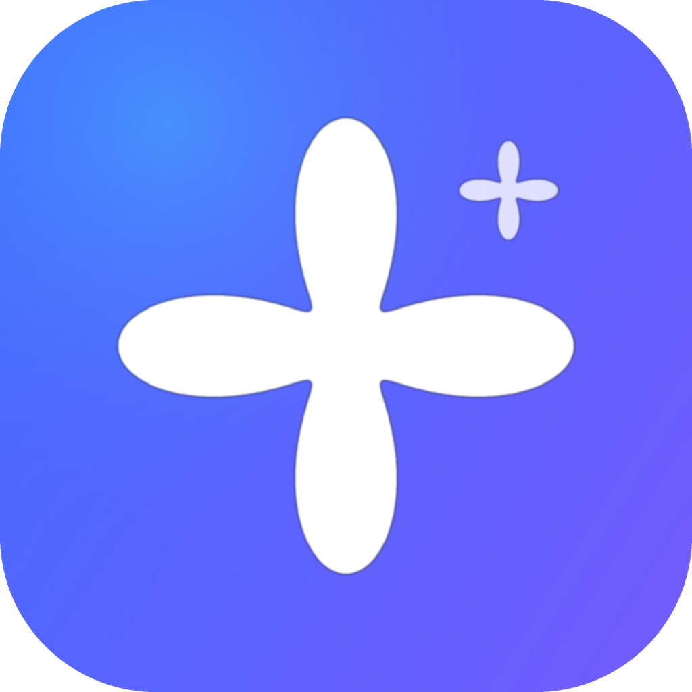
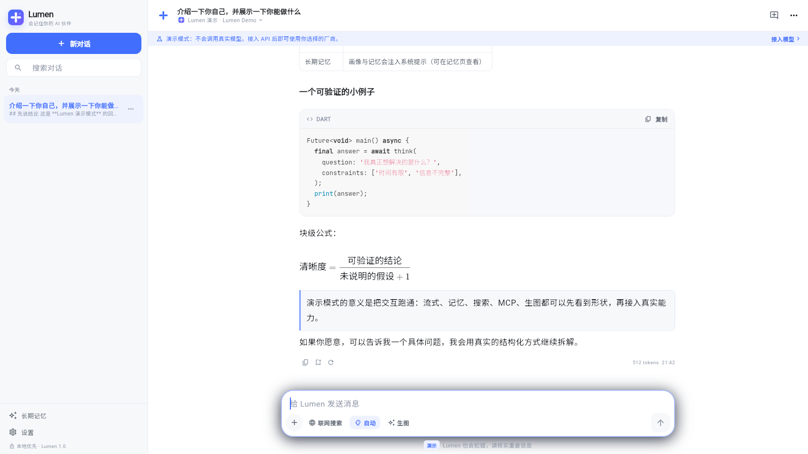
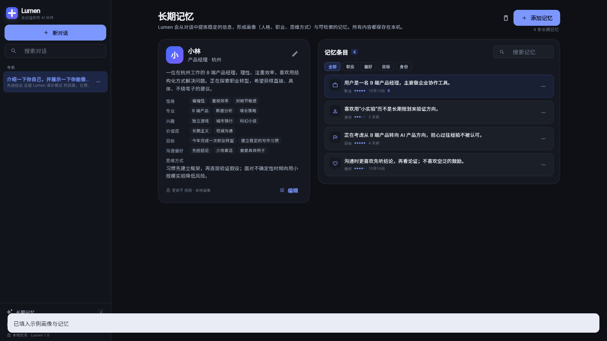

<div align="center">
  
  <h1>Lumen</h1>
  <p><strong>会记住你的本地优先 AI Agent</strong></p>
  <p>保存长期记忆，组织对话，连接你配置的模型服务。</p>

  [](https://flutter.dev)
  [](https://dart.dev)
  [](#android)
  [](#web)
  [](LICENSE)
  [](https://github.com/starsdragon/lumen/releases)
  [](https://github.com/starsdragon/lumen/stargazers)
</div>

Lumen 是一个本地优先的 Flutter AI 客户端，负责保存记忆、组织对话并连接你配置的模型服务。模型由你选，Key 由你保管，会话和记忆默认只存在本机。

## Promo

[观看 79 秒产品片](https://github.com/starsdragon/lumen/releases/download/v1.0.4/Lumen-1.0.4-promo.mp4) · [字幕](https://github.com/starsdragon/lumen/releases/download/v1.0.4/Lumen-1.0.4-promo.srt)

产品片用于展示界面方向，部分能力仍在开发中。

## 当前可用

- **长期记忆。** 对话后抽取用户画像和长期事实，画像按字段合并，记忆去重后按相关度、重要性和时间检索。所有内容都能在“长期记忆”里查看、编辑、置顶或删除。
- **模型服务配置。** 在设置里填写服务地址、API Key 和模型 ID；模型清单可以从服务端读取。客户端不绑定具体平台。
- **本地对话。** 流式回答、可折叠思考过程、工具调用卡片、Markdown、表格、代码块和公式。
- **MCP。** 支持 HTTP、SSE 和桌面端 stdio；工具以 `mcp__` 前缀注入。
- **本地优先。** 会话、消息、画像、记忆和 MCP 配置保存在本机；API Key 走系统安全存储。
- **演示模式。** 没有 API Key 也能先体验界面、流式输出、记忆和工具卡片。

## 界面

| 对话 | 长期记忆 |
|---|---|
|  |  |

截图来自 Web 演示模式；实际字体和窗口尺寸会随平台变化。

## 待实现 / 整理中

- **图片生成**：待实现。当前版本没有开放图片生成入口。
- **文件导入与联网搜索**：配置和交互仍在整理，README 暂不展开。
- **账号与云同步**：暂未提供，数据保持在当前设备。

## 快速开始

### 环境

- Flutter 3.38+，Dart 3.10+
- Android 构建需要 Android SDK 36（minSdk 24）
- Web 预览需要 Chrome 或 Edge

### Web

```bash
flutter pub get
flutter run -d chrome
```

构建静态文件：

```bash
flutter build web --release
cd build/web
python3 -m http.server 8137
# 打开 http://127.0.0.1:8137/
```

### Android

```bash
flutter build apk --release
# 产物：build/app/outputs/flutter-apk/app-release.apk
```

预构建 APK 见 [Releases](https://github.com/starsdragon/lumen/releases)。当前 release 包使用 Android debug 证书签名，正式分发前请换成自己的 keystore。

### 第一次打开

1. 选择“先体验演示模式”，不需要 Key。
2. 或打开“设置 → 模型与厂商”，填写服务地址、API Key 和模型 ID。
3. 需要 MCP 时，在“设置 → MCP”里添加 HTTP、SSE 或桌面 stdio server。

## 模型设置

- 模型服务由你自行配置，客户端不内置平台密钥。
- 服务地址、API Key、模型 ID 和请求参数都可以在设置里修改。
- 模型清单通过服务端接口读取；读取失败时保留本地缓存。
- 不同服务支持的参数不一致，客户端会按返回的错误做基础降级。

## 长期记忆

- 画像字段：称呼、职业、所在地、教育、性格、专业、兴趣、价值观、目标、沟通偏好、思维方式、综合摘要。
- 记忆条目有分类、重要度、来源会话、创建/更新时间；可搜索、筛选、编辑、置顶、删除。
- 自动抽取按对话轮次触发，抽取结果先合并画像、再去重事实。
- 检索使用本地词法匹配（中文 bigram + 英文词），按相关度、重要度、置顶和时间排序后注入系统提示。
- 个人规模下词法检索更容易解释、调试和离线运行；记忆量变大后可以替换检索实现。

## MCP

- Streamable HTTP、旧版 SSE；桌面端支持 stdio 本地进程，Android/Web 不支持 stdio。
- initialize 握手、`tools/list`、`tools/call`；工具以 `mcp__` 前缀注入。
- MCP 工具调用不会逐次弹确认，只连接你信任的 server。

## 架构

```text
lib/
  data/            模型、Sembast 数据库、Key 安全存储、默认配置
  services/
    api/           协议适配、流式解析、模型列表、请求参数
    chat_session   对话循环、工具执行、上下文裁剪、持久化、记忆抽取
    controllers    设置、模型、会话、记忆、MCP 状态
    memory_service 画像和记忆抽取
    mcp_client     MCP JSON-RPC（HTTP / SSE / stdio）
    toolbox        内置工具与 MCP 工具执行
  ui/              聊天、模型选择、记忆、设置、MCP、引导
```

- 客户端直接请求你配置的模型服务；API Key 不经过 Lumen 服务器。
- 对话循环把模型返回、工具执行和结果回填串起来，发送前按模型窗口裁剪上下文。
- 会话、消息、画像、记忆和 MCP 配置保存在本地数据库。

## 测试

```bash
flutter analyze
flutter test
```

测试覆盖数据层、协议解析、记忆、MCP 和基础界面组件。项目仍在快速迭代，README 不列固定测试数量。

## 已知限制

- 当前 APK 使用 Android debug 签名，正式分发前需要配置自己的 keystore。
- Web 版没有系统安全存储，API Key 会退回浏览器本地存储；不要在公共设备上使用。
- 产品按单设备本地使用设计，当前未包含账号体系、云同步与团队协作。
- 图片生成、文件导入和联网搜索仍在开发或整理中。
- 不同模型服务的参数和错误格式差异较大，适配范围以实际配置为准。

## Development

```bash
flutter pub get
flutter analyze
flutter test
flutter build web --release
flutter build apk --release
```

辅助脚本：

- `tools/mock_search_server.py`：本地搜索 mock，用于界面和工具链路测试。
- `tools/cdp_capture.mjs` / `tools/cdp_actions.mjs`：无头 Edge + CDP 截图与交互。
- `tool/live_opencode_check_test.dart`：需要 `OC_KEY` 的真实模型链路检查，不进入默认测试集。

如果 Gradle Wrapper 下载发行版时遇到证书问题，可以用 Android Studio 打开 `android/` 构建，或使用本机已缓存的 Gradle 发行版执行 `assembleRelease`。

## 安全与隐私

- API Key 存在系统安全存储（Android）或浏览器本地存储（Web）。
- 会话、消息、画像、记忆保存在本机；没有 Lumen 服务器，也没有账号。
- MCP server 能看到你交给它的参数和结果，只连接可信来源。
- 模型服务会收到你发送的对话内容；调用前请确认该服务的隐私政策。

## License

[MIT](LICENSE) © 2026 Lumen contributors.

界面节奏参考公开的 Android App 设计，没有复用其代码或资源。厂商名称、Logo 和商标归各自权利人所有。字体 Inter、Noto Sans SC、JetBrains Mono 使用 SIL Open Font License。
